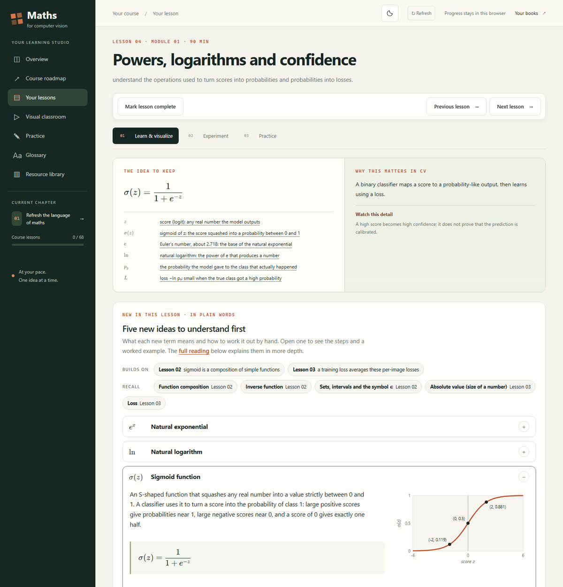
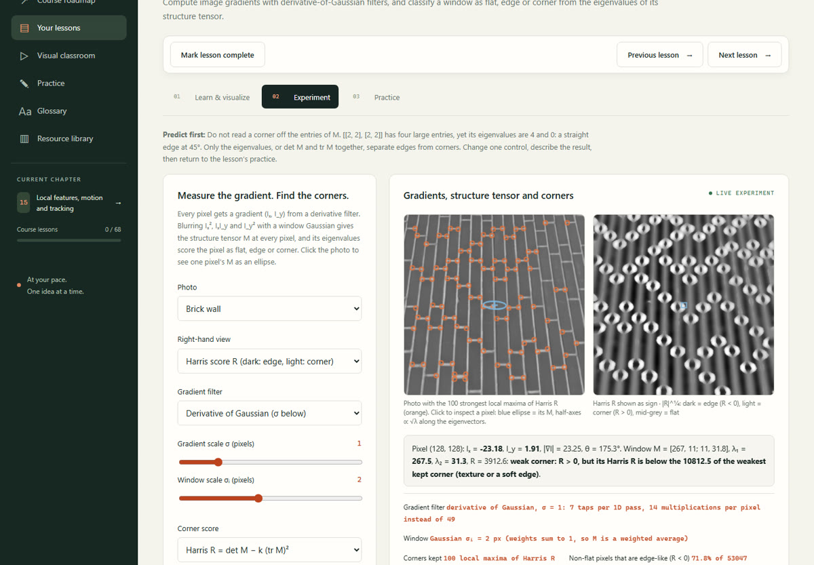
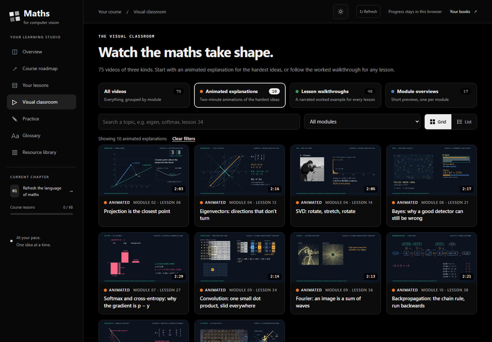

# Maths for Computer Vision

An interactive course that takes you from school algebra to the mathematics behind modern computer vision: 68 lessons in 17 modules, from images as arrays and dot products to epipolar geometry, diffusion models and 3D Gaussian splatting.

**Open the course: [jatin711-debug.github.io/maths-for-computer-vision](https://jatin711-debug.github.io/maths-for-computer-vision/)**. It runs entirely in your browser. Progress, notes and answers are saved in that browser only; nothing is sent anywhere.



## What is inside

- **68 lessons**, each with a reading, an equation card, a live worked example whose numbers follow its sliders, and a notation explorer.
- **Plain-word primers.** Every lesson opens with its new ideas explained for a beginner: what each one is, how to calculate it by hand, worked numbers, a small graph and the usual mistake. All 355 terms are collected in a searchable **Glossary**. Maths that later lessons need (cos and sin, determinants, complex numbers, integrals, the multivariate Gaussian, the cross product and more) is taught where it is first used.
- **46 interactive experiments**, most on real photographs: filtering and Fourier analysis, SVD compression, corners and feature matching, optical flow, Kalman tracking, epipolar lines, block-matching stereo, ICP, a ray-marched volume, Hungarian box matching, EM and a small VAE trained in the browser, diffusion sampling and a Gaussian-splat renderer.
- **Auto-checked practice** with fresh numbers each time (314 question types), hints, worked solutions, spaced review, an automatic error log and a five-question checkpoint per module.
- **Python in the browser.** Every lesson has an editable NumPy example that runs locally via Pyodide; 13 also have optional PyTorch versions.
- **75 videos:** 10 two-minute animated explanations of the hardest ideas (projection, eigenvectors, SVD, Bayes, softmax and cross-entropy, convolution, Fourier, backpropagation, homographies, attention), a narrated worked walkthrough for each of Lessons 1-48, and a short overview per module.
- **14 Jupyter notebooks** (NumPy only): one for each core module, plus two for the extension, with predict-then-run checks.
- **12 Practical CV labs** connect the maths to local image projects: data audits, OpenCV counting, PyTorch classification and transfer learning, detection, segmentation, geometry, optional CLIP/SAM, inference and a capstone. Each lab has a place in the weekly plan, right after the lessons it needs. Readings and saved evidence checklists are in the **Practical CV** sidebar; training uses installed Python. Start with the [setup guide](course/practical/README.md).



## Syllabus

| Step | Module | Title | Lessons | Weeks |
|---|---|---|---|---|
| 1 | 01 | Refresh the language of maths | 01, 02, 03, 04 | 1-2 |
| 2 | 02 | Vectors, geometry and linear maps | 05, 06, 07, 08 | 3-4 |
| 3 | 09 | Images, convolution and frequency | 33, 34, 36 | 5-6 |
| 4 | 03 | Linear systems and least squares | 09, 10, 11, 12 | 7-8 |
| 5 | 04 | Eigenvectors, SVD and PCA | 13, 14, 15, 16 | 9-10 |
| 6 | 05 | Calculus for learning | 17, 18, 19, 20 | 11-12 |
| 7 | 06 | Probability, noise and uncertainty | 21, 22, 23, 24 | 13-14 |
| 8 | 08 | Optimization: descent, momentum and curvature | 29, 30, 31 | 15-16 |
| 9 | 07 | Statistical learning and losses | 25, 26, 27, 28 | 17-18 |
| 10 | 10 | Neural networks and backpropagation | 37, 38, 32, 35, 39, 40 | 19-21 |
| 11 | 11 | Recognition, detection and segmentation | 41, 55, 42, 43, 44, 56 | 22-26 |
| 12 | 12 | Capstone and a route into research | 45, 46, 47, 48 | 27-28 |
| 13 | 13 | Geometry of images and cameras | 49, 50, 51, 52 | 29-30 |
| 14 | 14 | Matrix calculus and information theory | 53, 54 | 31 |
| 15 | 15 | Local features, motion and tracking | 57, 58, 59, 60 | 32-34 |
| 16 | 16 | Two-view geometry and neural rendering | 61, 62, 63, 64 | 35-37 |
| 17 | 17 | Set prediction, generative models and splatting | 65, 66, 67, 68 | 38-40 |

Modules 1-12 form a 28-week core at 8-10 hours a week; Modules 13-17 are an optional 12-week extension. Lesson and module numbers are permanent labels, so follow the steps in this order: filters come early because they need only vectors, and gradient descent comes before the classifier that uses it. The full plan, outcomes and mastery gates are in [course/syllabus.md](course/syllabus.md).



## Run it on your own computer

The maths course is a static site; it needs no build step and no internet once downloaded. Practical lab readings also work offline, but their local Python dependencies, datasets and optional pretrained models need an initial download.

```bash
git clone https://github.com/jatin711-debug/maths-for-computer-vision.git
cd maths-for-computer-vision
python course/serve_course.py
```

Then open http://127.0.0.1:50101/course/. On Windows you can instead double-click **Open Course.cmd**. Opening `course/index.html` directly from disk also works, but the in-browser Python runner and video captions need the local server.

## Books

Lessons cite four books, and every reading reference links to the exact PDF page of the cited section. The PDFs are **not** included. Two are free from their authors: *Mathematics for Machine Learning* (Deisenroth, Faisal and Ong) and *Computer Vision: Algorithms and Applications* (Szeliski). See [course/resources/README.md](course/resources/README.md) for all four, and save your copies there so the page links open locally.

## For contributors

- Lessons 1-48 live in shared data files (`teaching-data.js`, `lesson-guides.js`, `lesson-tutor.js`, `practice-bank-*.js`); Lessons 49-68 are self-contained in `course/lessons/NN-*.md`, `course/extensions/lesson-NN.{js,json}` and `course/extension_examples/lesson_NN.py`.
- Primers are in `course/primers/*.js` (schema at the top of `course/primers.js`).
- `python course/build_web_data.py` rebuilds `course-data.js` from the Markdown lessons (needs `pypdf` only if the book PDFs are present).
- `course/study-path.json` is the single source of truth for study order. After changing it or a module, run `python course/build_web_data.py`, then `python course/build_syllabus.py`. `python course/build_core_notebooks.py` rebuilds and runs the notebooks for Modules 2-12.
- Checks, all currently at 0 issues: `node course/validate_path.cjs`, `node course/validate_lessons.cjs`, `node course/validate_practice.cjs`, `node course/validate_primers.cjs` and `python course/validate_python_examples.py` (NumPy, optionally PyTorch).
- More detail on how each part was built and validated is in [course/README.md](course/README.md).
- Practical checks: `python -m unittest discover -s course/practical/tests -v`, `python course/practical/build_catalog.py --check` and `node course/validate_practical.cjs`. See [practical validation](course/practical/validation.md) for the tested environment and limits.

Found a mistake? Please open an issue with the lesson number and what looks wrong.

## How it was made

The lessons, experiments, practice generators and videos were written with AI assistance (Anthropic's Claude) and checked by script: every worked number, practice answer and primer example is verified in Python, and the validators above run across all lessons. The explanations have not been reviewed by an independent computer-vision expert, so cross-check anything surprising against the books. The animated explanations were rendered with [fframes](https://github.com/dmtrKovalenko/fframes), and all narration was synthesized locally with [Kokoro-82M](https://huggingface.co/hexgrad/Kokoro-82M).

## Licence

- Code (JavaScript, Python, CSS, HTML and scripts): [MIT](LICENSE).
- Course content (lesson text, primers, exercises, notebooks' prose, images and videos): [CC BY 4.0](LICENSE-CONTENT.md). You may share and adapt it, including commercially, with credit.
- Third-party components keep their own licences: [KaTeX](https://katex.org/) (MIT, `course/vendor/katex`), the [Pyodide](https://pyodide.org/) runtime with CPython, Emscripten and NumPy (MPL-2.0, PSF, MIT and BSD; licence files in `course/vendor/pyodide`), sample photographs from [scikit-image](https://scikit-image.org/) (CC0), and Kokoro-82M voice output (Apache-2.0).
